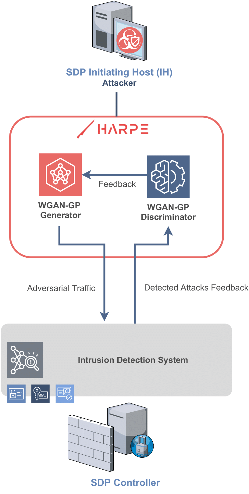
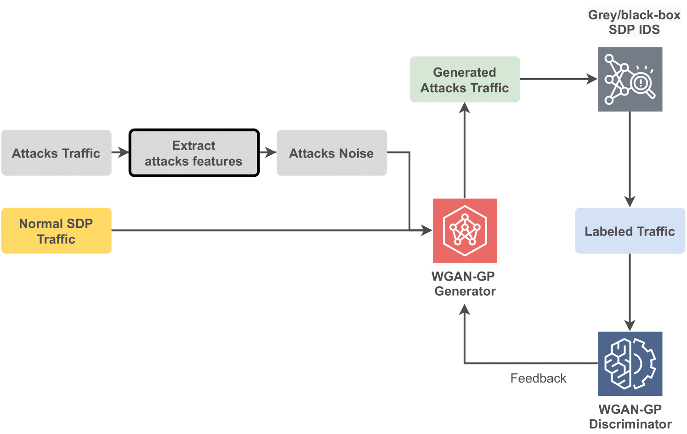

# Harpe


**Using Adversarial Machine Learning to dodge Intrusion Detection Systems in Software-Defined Perimeters.**

Harpe is the offensive counterpart of [Apollon](https://github.com/antoniopaya22/apollon): where Apollon defends an IDS against adversarial examples, Harpe shows how an attacker can generate them to slip past the IDS that protects a Software-Defined Perimeter.

## Abstract

With the increasing reliance on Software-Defined Perimeters (SDPs) for network security, it is
important to understand the limitations and vulnerabilities of this architecture. This paper proposes
a framework, Harpe, that generates attacks on SDP-based networks to demonstrate the potential
weaknesses of this architecture. Harpe generates malicious network traffic that mimics normal
traffic to evade the Intrusion Detection System (IDS) component of SDPs. Utilizing Adversarial
Machine Learning techniques, it learns how the IDS operates and finds ways to evade detection. The
effectiveness of the proposed framework is tested in two different environments, a traditional network
architecture and an SDP-based network. The results show that Harpe is capable of significantly
reducing the detection capabilities of the IDS in both environments, highlighting the need for further
research and improvement of SDP security mechanisms.

## How it works

1. Network flows are preprocessed (feature selection, log transforms, scaling and one-hot encoding).
2. A **Wasserstein GAN with gradient penalty (WGAN-GP)** learns to generate malicious traffic whose features look like benign traffic.
3. The adversarial traffic is evaluated against several IDS classifiers and inside a real **SDP lab** (controller, gateway with fwknop and client), using CICFlowMeter to extract flows.

<p align="center">
  
  
</p>

## Results

Detection rate of the IDS before and after Harpe's adversarial traffic (MLP, SVM, NB, LR and RF classifiers):

| Dataset | Original traffic | Adversarial traffic |
|---|---|---|
| CIC-IDS2017 | 91.5 – 97.8 % | **0.0 %** |
| CSE-CIC-IDS2018 | 92.0 – 99.0 % | **0.0 – 0.5 %** |
| CIC-DDoS2019 | 84.2 – 87.1 % | **0.0 %** |
| UNSW-NB15 | 75.7 – 87.2 % | **0.0 – 0.8 %** |

Full per-model metrics (accuracy, detection rate and evasion increase rate) are in [`results/performance/`](results/performance).

## Repository structure

```text
harpe/
  preprocessing/   # dataset loading and feature transformations
  wgan/            # WGAN-GP generator, discriminator and training loop
sdp-environment/   # docker-compose SDP lab: controller, gateway (fwknop), client,
                   # MySQL, CICFlowMeter and a Slowloris DDoS script
results/           # evaluation results per dataset
documentation/     # architecture diagrams
```

## Getting started

```bash
python -m venv .venv && source .venv/bin/activate
pip install torch numpy pandas scikit-learn
```

The SDP lab used for the end-to-end experiments:

```bash
cd sdp-environment
docker compose up -d --build
```

## Related work

- [Apollon](https://github.com/antoniopaya22/apollon): the defence. Payá *et al.*, [Computers & Security 136, 103546 (2024)](https://doi.org/10.1016/j.cose.2023.103546).
- [Software-Defined-Perimeter](https://github.com/antoniopaya22/Software-Defined-Perimeter): the SDP deployment this lab is based on.
